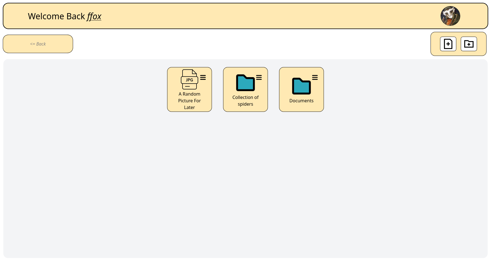

# Uploader TOP

My Personal recreation of the "File Uploader" project from "The Odin Project":



## Table Of Contents

- [Overview](#overview)
- [Built With](#built-with)
- [Getting Started With](#getting-started)
- [Features](#features)
- [Acknowledgements](#acknowledgements)
<!-- - [Contact](#contact) -->

## Overview

<!-- TODO: Add a screenshot of the live project.
    1. Link to a 'live demo.'
    2. Describe your overall experience in a couple of sentences.
    3. List a few specific technical things that you learned or improved on.
    4. Share any other tips or guidance for others attempting this or something similar.
 -->

## Built With

As reccomended by "The Odin Project" i have used Mainly Node with express and passport to authenticate and maintain the session live.
I also used supabase, for both the database and the storage of the file.

* [![Node][Node.com]][Node-url]
* [![ExpressJs][ExpressJs.com]][Express-url]
* [![supabase][supabase.com]][supabase-url]
* [![TypeScript][TypeScript.com]][TypeScript-url]
* [![prisma][prisma.com]][prisma-url]


<!-- TODO: List any MAJOR libraries/frameworks (e.g. React, Tailwind) with links to their homepages. -->

## Getting Started

After cloning the repo you need to run

```
npm install
cd uploaderTOP
cp ./.env.example ./.env
```

Then you can just fill out the new `.env` and use any of the commands like `npm run local`

## Features

- Uploading any type of file
- Displaying the file type on the icon
- Grouping them with folders
- Renaming the folders
- Sharing the file and being able to decide the duration of the shareSession [To Finish], and if they can edit it or not.

<!-- ## Contact -->
<!---->
<!-- Idk, right here i guess -->
<!-- TODO: Include icons and links to your RELEVANT, PROFESSIONAL 'DEV-ORIENTED' social media. LinkedIn and dev.to are minimum. -->

## Acknowledgements

Thanks to "The Odin Project" for creating all of their courses and projects

<!-- MARKDOWN LINKS & IMAGES -->
<!-- https://www.markdownguide.org/basic-syntax/#reference-style-links -->
[Node.com]: https://img.shields.io/badge/node.js-339933?style=for-the-badge&logo=Node.js&logoColor=white
[Node-url]: https://nodejs.org/en
[ExpressJs.com]: https://img.shields.io/badge/express.js-000000?style=for-the-badge&logo=express&logoColor=white
[Express-url]: https://expressjs.com
[supabase.com]: https://img.shields.io/badge/Supabase-3ECF8E?style=for-the-badge&logo=supabase&logoColor=white
[supabase-url]: https://supabase.com
[TypeScript.com]: https://img.shields.io/badge/TypeScript-3178C6?style=for-the-badge&logo=typescript&logoColor=white
[TypeScript-url]: https://www.typescriptlang.org
[prisma.com]: https://img.shields.io/badge/Prisma-3982CE?style=for-the-badge&logo=Prisma&logoColor=white
[prisma-url]: https://www.prisma.io
