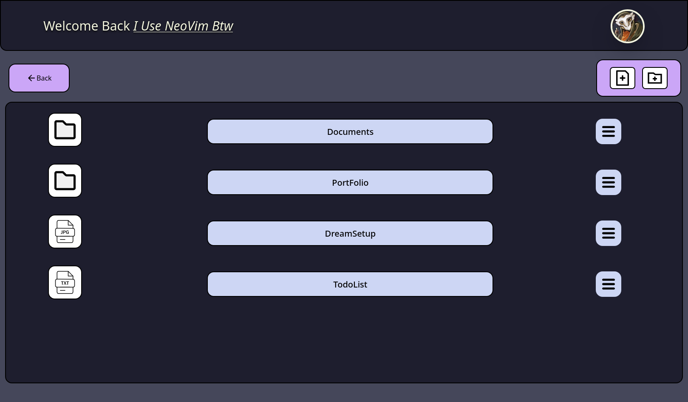

# File Uploader


My Recreation of the File Uploader Project with cloud storage and user access.




## Table Of Contents

- [Overview](#overview)
- [Built With](#built-with)
- [Getting Started With](#getting-started)
- [Features](#features)
- [Acknowledgements](#acknowledgements)
<!-- - [Contact](#contact) -->

## Overview

Recreated this project from the course project known as "The Odin Project"<br>
The instructions suggested the use of express and ejs in the creation of a Google Drive similar app

Learner quite a few things in the course of this project<br>
However, the ones i feel were the most usefull were:

- TypeScript and Type-Safety<br>
Even tho the curriculum of The Odin Project does not cover Typescript i had a great time<br>
Particularly once i started integrating the types inside the error handling and getting better error management

- Securing the file id when sharing:<br>
Made sure to change the id of the file before sharing, that way the owner of the file would be able to share without enabling editing of the folder
and without fear that a malicious user was able to delete files once revealed the id

- Securing the types of file upload:<br>
Secured the input of files through their magic numbers, however annoyingly enought, simple plain files like text don't have a singular way to write it, but multiple, making the check not 100% accurate, and resorted to using multer for those

- Creating users and securint their passwords and sessions with express-session and bcrypt
- Escaping user input in username and file name with the ejs syntax
- Full test coverage using vitest and supertest


## Built With

Used Node with the help of express.js and PrismaOrm to authenticate the user<br>
Handle the route requests, and keep the session safe, and used supabase for the Storage and vitest to make sure everything was working as expected

* [![Node][Node.com]][Node-url]
* [![ExpressJs][ExpressJs.com]][Express-url]
* [![supabase][supabase.com]][supabase-url]
* [![TypeScript][TypeScript.com]][TypeScript-url]
* [![prisma][prisma.com]][prisma-url]
* [![Vitest][vitest.com]][vitest-url]
* [![TailWind css][Tailwind.com]][tailwindcss-url]

<!-- TODO: List any MAJOR libraries/frameworks (e.g. React, Tailwind) with links to their homepages. -->

## Getting Started

After cloning the repo you need to run

```
cp ./.env.example ./.env
npm install
npx supabase start
```

Get the supabase links:
 
- Secret key
- database url inside the 'Direct Url' 
- supabase studio link inside the 'SUPABASE_URL'
- fill out the 'EXPRESS_SESSION' with something random

```
npx prisma migrate dev -n GreatProject && npx prisma generate
npm run local
```


## Features

- Uploading any type of file
- Displaying the file type on the icon
- Grouping them with folders
- Renaming the folders and files
- Sharing a link to a file and it being deleted automatically once the session expires


<!-- ## Contact -->
<!---->
<!-- Idk, right here i guess -->
<!-- TODO: Include icons and links to your RELEVANT, PROFESSIONAL 'DEV-ORIENTED' social media. LinkedIn and dev.to are minimum. -->

## Acknowledgements

Thanks to "The Odin Project" for creating all of their courses and projects.
Thanks to the team at Catppuccin for the amazing colorscheme i could not give justice to in my site

<!-- MARKDOWN LINKS & IMAGES -->
<!-- https://www.markdownguide.org/basic-syntax/#reference-style-links -->
[Node.com]: https://img.shields.io/badge/node.js-339933?style=for-the-badge&logo=Node.js&logoColor=white
[Node-url]: https://nodejs.org/en
[ExpressJs.com]: https://img.shields.io/badge/express.js-000000?style=for-the-badge&logo=express&logoColor=white
[Express-url]: https://expressjs.com
[supabase.com]: https://img.shields.io/badge/Supabase-3ECF8E?style=for-the-badge&logo=supabase&logoColor=white
[supabase-url]: https://supabase.com
[TypeScript.com]: https://img.shields.io/badge/TypeScript-3178C6?style=for-the-badge&logo=typescript&logoColor=white
[TypeScript-url]: https://www.typescriptlang.org
[prisma.com]: https://img.shields.io/badge/Prisma-3982CE?style=for-the-badge&logo=Prisma&logoColor=white
[prisma-url]: https://www.prisma.io
[vitest.com]: https://img.shields.io/badge/Vitest-6E9F18?style=for-the-badge&logo=vitest&logoColor=fff
[vitest-url]: https://vitest.dev
[Tailwind.com]: https://img.shields.io/badge/Tailwind%20CSS-%2338B2AC.svg?style=for-the-badge&logo=tailwind-css&logoColor=white
[tailwindcss-url]: https://tailwindcss.com
